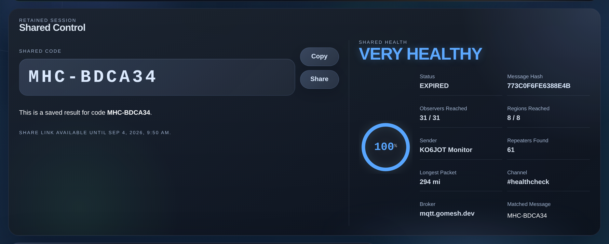
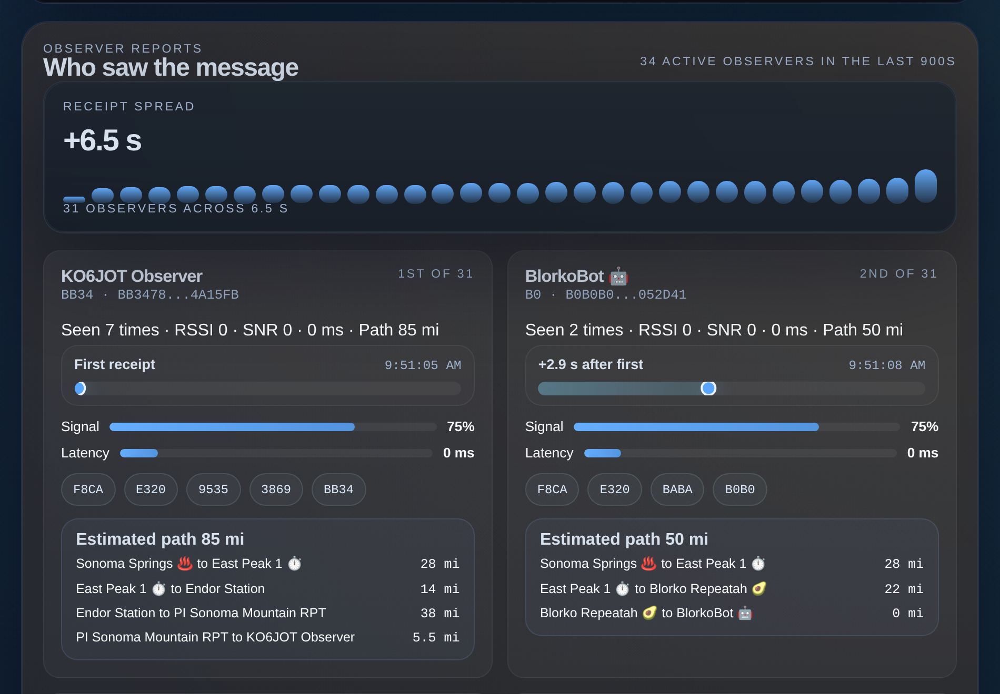
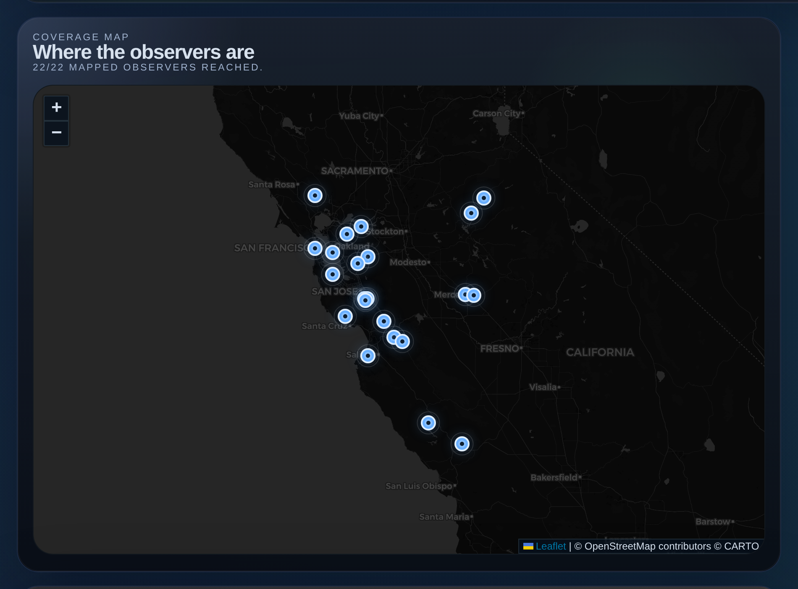

# Bay Area Mesh Health Check

[](https://gitlab.com/tmcgee/bayarea-mesh-health-check/-/pipelines?ref=main)
[](package.json)
[](LICENSE)

A self-hosted web app for measuring MeshCore message coverage across
MQTT-connected observers. It generates a short code, watches the configured
MeshCore group channel for that code, then scores how many active observers
heard the matching message.

This is the **Bay Area** fork of
[yellowcooln/meshcore-health-check](https://github.com/yellowcooln/meshcore-health-check),
live at [healthcheck.bayareameshcore.org](https://healthcheck.bayareameshcore.org/).
It branched at upstream `v1.3.7`, merged `v1.3.8`, and brings later upstream work
in one feature at a time. The original app came from the Boston MeshCore
community ([healthcheck.bostonme.sh](https://healthcheck.bostonme.sh/)), and the idea
for it came from Nick D. Thanks to yellowcooln and the upstream contributors.

What the fork changes: Bay Area region boundaries and groups, scoring against
every active observer instead of a fixed top 10, MeshCore region scopes and
regional test channels, and a reworked dashboard. [CHANGES.md](CHANGES.md)
lists each release and [docs/bay-area-adaptation.md](docs/bay-area-adaptation.md)
explains why.

Versions are this fork's own SemVer with the upstream base as build metadata:
`1.0.0+upstream.1.3.8` is fork release 1.0.0, built on upstream `v1.3.8`. Major
releases break existing setups (env, API or stored data), minor ones add
features, patches fix. Releases before 1.0.0 were `1.3.8+bayarea.1` to `.22`.

Changes are made on [GitLab](https://gitlab.com/tmcgee/bayarea-mesh-health-check)
and mirrored to [GitHub](https://github.com/tmcgee/bayarea-mesh-health-check).
Issues are welcome on GitHub; pull requests there are applied on GitLab.
[docs/deploy-cloudflare-tunnel.md](docs/deploy-cloudflare-tunnel.md) covers
self-hosting.

Other community Health Checks:

- https://healthcheck.bostonme.sh/ - Boston, the upstream original
- https://healthcheck.ukmesh.com/ - UK Mesh Health Check





## What It Does

- creates short-lived health-check codes
- matches MeshCore `GroupText` packets from MQTT
- scores coverage against every observer active in the last few minutes
- shows receipts, paths, RSSI, SNR, timing, repeaters, and map coverage
- estimates packet-path distance between known observers, with mile or
  kilometer labels
- learns observer names and locations from MQTT metadata
- tracks recent observer activity
- groups observers into regions, subregions and parent regions from a GeoJSON
  boundary file
- recognises MeshCore region scopes and `#<region>-healthcheck` test channels
- keeps retained `/share/:sessionId` result links
- supports Cloudflare Turnstile and installable PWA behavior

## Quick Start

Clone the repo and run the local Compose build:

```bash
git clone https://github.com/tmcgee/bayarea-mesh-health-check.git
cd bayarea-mesh-health-check
cp .env.example .env
docker compose up -d --build
```

`.env.bayarea.example` is the Bay Area configuration to start from instead.
The GitLab URL clones the same history.

Default local URL: `http://localhost:3090`

This fork publishes no Docker image; Compose builds it locally. The
`yellowcooln/meshcore-health-check` images on Docker Hub are upstream's app, not
this fork. The Bay Area deployment runs as a systemd service; see
[docs/deploy-cloudflare-tunnel.md](docs/deploy-cloudflare-tunnel.md).

At minimum, configure MQTT and the test channel in `.env`:

- `MQTT_HOST`, `MQTT_PORT`, `MQTT_TRANSPORT`, `MQTT_TLS`
- `MQTT_USERNAME`, `MQTT_PASSWORD` when required
- `MQTT_TOPIC`
- `TEST_CHANNEL_NAME`
- `TEST_CHANNEL_SECRET` or `TEST_CHANNEL_HASH`
- `CARTO_BASEMAP_KEY` to enable CARTO coverage-map tiles

For full setup steps, read [HOWTO.md](HOWTO.md). For every runtime variable,
read [ENVIRONMENT.md](ENVIRONMENT.md).

## Project Layout

- [server.js](server.js): Express API, MQTT ingest, MeshCore decoding, session
  matching, observer persistence, Turnstile handling, and WebSocket snapshots
- [public/](public): dashboard, share page, landing page, styles, and service
  worker
- [data/observer.json](data/observer.json): observer names and coordinates
- [data/observer-activity.json](data/observer-activity.json): rolling observer
  packet history used for dynamic defaults
- [data/session-results.json](data/session-results.json): retained share-link
  session results
- [.env.example](.env.example): runtime config template
- [ENVIRONMENT.md](ENVIRONMENT.md): full environment variable reference
- [HOWTO.md](HOWTO.md): deployment and operator guide
- [CHANGES.md](CHANGES.md): release changelog

## Runtime Notes

- The app only decodes the configured test channel.
- Docker Compose and the systemd unit in `scripts/` are both supported.
- Keep `data/` mounted if observer profiles, observer activity, and share links
  must survive rebuilds.
- `OBSERVER_TARGET_MODE=active` (the Bay Area setting) scores every active
  observer. `KNOWN_OBSERVERS` still pins a fixed set if you need one.
- Set `OBSERVER_RETENTION_SECONDS=0` to keep known observers visible regardless
  of age.
- Share links use retained server-side results and remain available until
  `RESULT_RETENTION_SECONDS` expires.
- `DASH_BROKER_HOST` changes only the broker label shown in the UI. It does not
  change the actual MQTT connection.
- `CORESCOPE_URL` changes the matched message-hash link to CoreScope
  `#/packets/<hash>` routes.
- `CARTO_BASEMAP_KEY` enables CARTO raster tiles. Without it, the coverage map
  falls back to OpenStreetMap while the dark dashboard theme remains usable.
  The older `CARTO_API_KEY` name is still accepted.
- `DISTANCE_UNIT=mi` or `DISTANCE_UNIT=km` controls packet distance labels.

## Validation

```bash
npm run check
npm test
docker compose up -d --build
curl -s http://localhost:3090/api/bootstrap
```

Run `npm run test:smoke` when UI or routing behavior changes.

## Decoder

The app uses `@michaelhart/meshcore-decoder` for runtime MeshCore packet
decoding. A small postinstall compatibility patch keeps the published CommonJS
build loading cleanly on Node 18.

## License

MIT; see [LICENSE](LICENSE). Upstream code is Copyright (c) 2026 yellowcooln and
contributors; the Bay Area changes are Copyright (c) 2026 Tim McGee.
[NOTICE.md](NOTICE.md) lists the bundled data and dependencies and their licenses.

## Upstream Star History


<a href="https://www.star-history.com/?repos=yellowcooln%2Fmeshcore-health-check&type=date&legend=top-left">
 <picture>
   <source media="(prefers-color-scheme: dark)" srcset="https://api.star-history.com/chart?repos=yellowcooln/meshcore-health-check&type=date&theme=dark&legend=top-left" />
   <source media="(prefers-color-scheme: light)" srcset="https://api.star-history.com/chart?repos=yellowcooln/meshcore-health-check&type=date&legend=top-left" />
   
 </picture>
</a>
